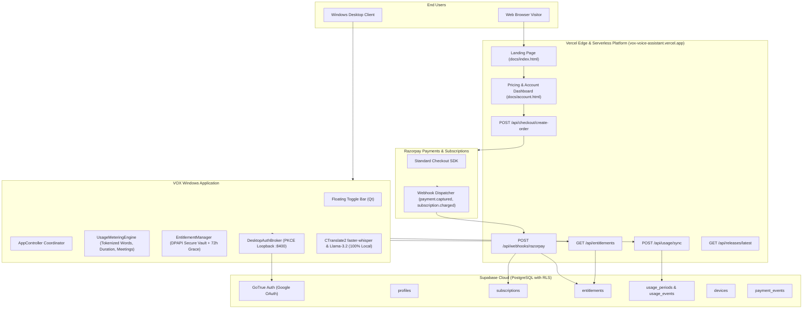

# VOX — Commercial Architecture Specification

**System:** VOX Commercial Ecosystem  
**Target Environment:** Vercel Serverless + Supabase PostgreSQL + Razorpay + Windows 10/11 Desktop  

---

## 1. High-Level System Architecture



---

## 2. Data Flow & Security Boundaries

### Security Boundary 1: Zero Audio / Text Uploads
- **Invariant:** Neither Vercel, Supabase, nor Razorpay ever receives microphone audio, loopback audio, video frames, transcript text, or meeting notes.
- **Payload exchanged with `/api/usage/sync`:**
  ```json
  {
    "device_id": "win-hwid-sha256",
    "events": [
      {
        "event_id": "550e8400-e29b-41d4-a716-446655440000",
        "metric": "dictation_words",
        "amount": 84,
        "timestamp_utc": "2026-11-15T08:30:00Z"
      }
    ]
  }
  ```

### Security Boundary 2: Server-Signed Entitlement Tokens
- Entitlements are signed server-side using a private key (`ENTITLEMENT_SIGNING_KEY`).
- Desktop verifies signature and expiration.
- Cached locally using Windows Data Protection API (`CryptProtectData`), preventing ordinary users from editing SQLite or JSON to unlock Pro.
- Grants up to **72 hours of offline grace**; if disconnected beyond 72 hours, quota-controlled operations pause gracefully with a prompt to connect.

### Security Boundary 3: Webhook Verification & Idempotency
- All Razorpay webhooks (`X-Razorpay-Signature`) are cryptographically verified using `HMAC-SHA256` with the webhook secret.
- Every payment event is checked against `payment_events` by `provider_event_id` before processing. Duplicate webhooks return `200 OK` immediately without duplicate ledger mutations.

---

## 3. Database Schema Overview (Supabase PostgreSQL)

1. `profiles`: Links Google OAuth user ID to display name, email, and timestamps.
2. `plans`: Catalog of plans (`free`, `pro_monthly`, `pro_annual`) with limits.
3. `subscriptions`: Tracks Razorpay subscription ID, plan code, status (`active`, `past_due`, `cancelled`), and current period start/end.
4. `entitlements`: Active entitlement snapshot issued to the user.
5. `usage_periods`: Tracks aggregated weekly usage per metric (starts Monday 00:00 UTC).
6. `usage_events`: Append-only, idempotent ledger of individual reported usage events.
7. `devices`: Registered Windows devices running VOX per user account.
8. `payment_events`: Idempotency log of all processed payment transactions and webhooks.
